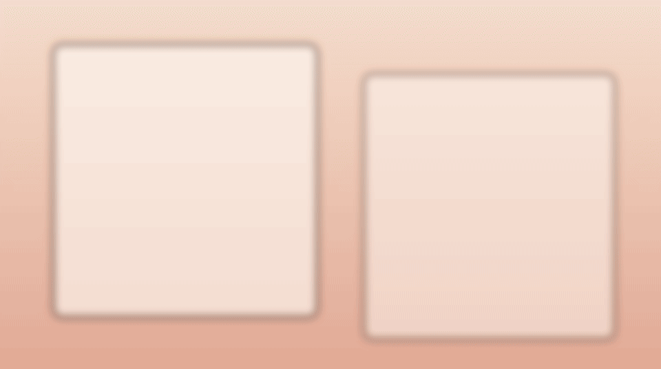
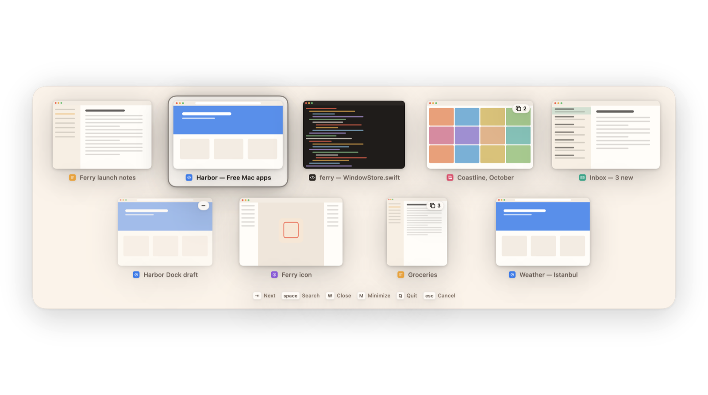
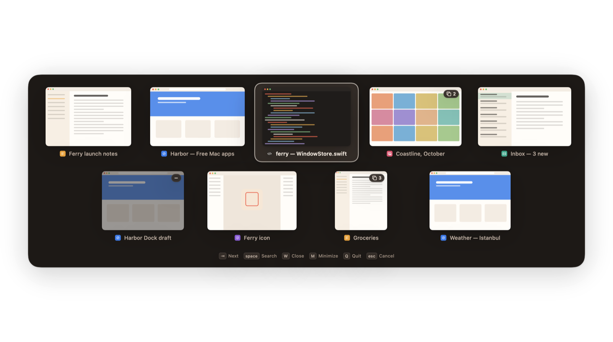
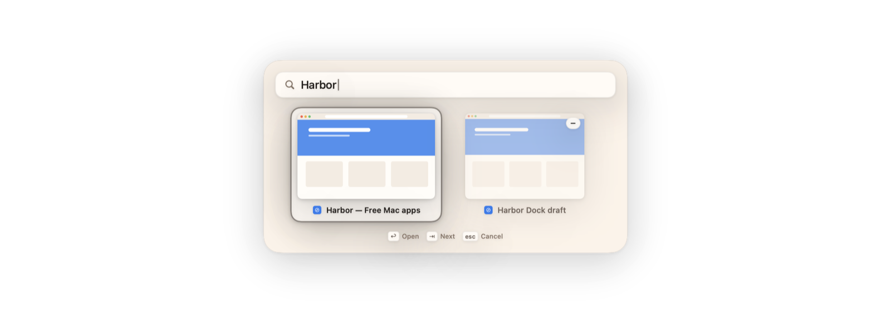
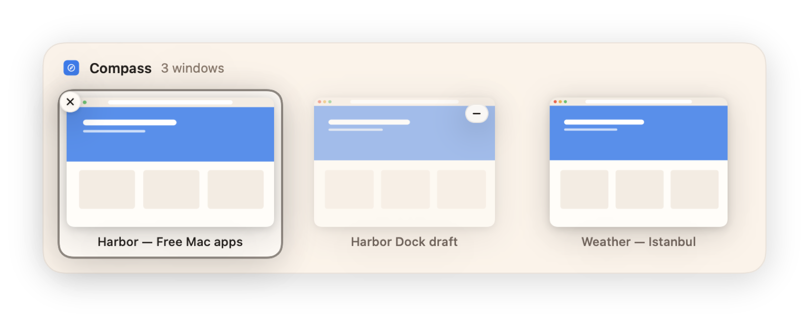
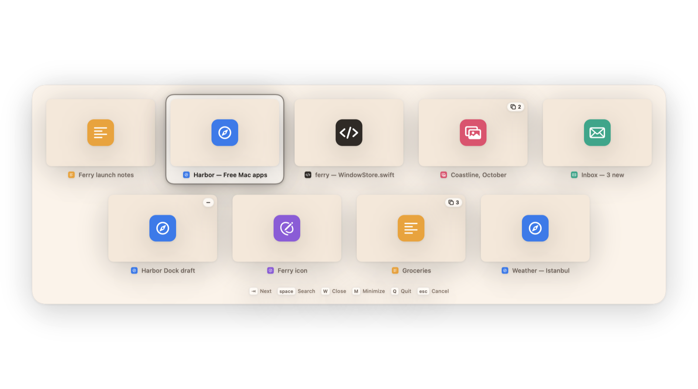

<p align="center">
  
</p>

<h1 align="center">Ferry</h1>

<p align="center">
  <b>Every window, one Tab away.</b><br>
  A free, open-source window switcher for macOS: hold ⌥, tap Tab, and see every window —<br>
  on every Space, with live pictures, search, quick actions and Dock previews.
</p>

<p align="center">
  <a href="https://github.com/Kaandis/ferry/releases/latest"></a>
  
  
  <a href="LICENSE"></a>
</p>

<p align="center">
  <a href="https://kaandis.github.io/ferry/">Website</a> ·
  <a href="https://github.com/Kaandis/ferry/releases/latest/download/Ferry.zip">Download</a> ·
  <a href="README.tr.md">Türkçe</a>
</p>

<p align="center">
  
</p>

## What it does

| | |
|---|---|
| **Windows, not apps** — hold ⌥ and tap Tab. Every window gets its own tile, most recently used first, so three browser windows are three choices. Let go to switch. A quick tap swaps to your previous window without the panel ever showing. |  |
| **Every Space** — windows on other desktops, minimized and hidden ones are all there, with a small badge that says where they are. Picking one takes you there. |  |
| **Search** — press Space while the switcher is open and type. Matches window titles and app names; Return switches. |  |
| **Dock previews** — rest the pointer on a Dock icon to see that app’s windows. Click one to bring it forward, or close it right there. |  |
| **Works without pictures** — Screen Recording is optional. Without it, tiles show app icons and everything else works the same. |  |

Also: **W** closes, **M** minimizes, **Q** quits and **H** hides the selected window’s app without letting go; arrow keys and the mouse work too. Use ⌥Tab, ⌘Tab (Ferry takes it over and hands it back on quit) or ⌃Tab. Panels come in Harbor’s cream or in Liquid Glass (macOS 26 and later), and the selection ring takes the highlight colour you pick (a soft pebble grey by default), both in **Settings → General**. It opens on the display with the pointer, follows Reduce Motion, Reduce Transparency and Increase Contrast, and speaks English and Turkish.

## Why it works this way

- **Asleep until you need it.** No polling, no timers between uses and no global mouse monitor. Ferry listens to keyboard events only (to catch the shortcut) and to Accessibility notifications that fire when focus really changes. Dock previews follow the Dock’s own hover highlight instead of tracking the mouse.
- **The window list is built when you press the shortcut.** It takes about 20–50 ms, off the main thread, so nothing has to be kept warm in the background. Apps that quit are forgotten at once, so nothing piles up over weeks of uptime.
- **Pictures are taken, not streamed.** ScreenCaptureKit takes one small still image per window (at most 560 px on the long side) when the switcher or a Dock preview is about to show it, and when you leave an app. macOS can’t picture windows on other Spaces, so Ferry keeps the last picture it took while the window was on screen.
- **Windows on other Spaces without guesswork.** A window’s Space comes from WindowServer, its title and role from Accessibility. Apps keep closed windows around (Music and Calendar do), and those still report a Space; Ferry only lists windows WindowServer says are actually shown. Untitled windows are checked through Accessibility too, so helper windows don’t sneak in.
- **No flicker on a quick tap.** The panel waits 90 ms before appearing. Tap and release fast and you just land on the previous window, the way the system switcher feels.
- **Springs, not timelines.** The panel and the selection ring move on critically damped springs that start from wherever they are, so you can reverse halfway and nothing bounces. The panel’s entrance and exit run in Core Animation, so its content is drawn once. With Reduce Motion it simply fades.
- **Dock previews leave when you do.** While a preview is up, and only then, Ferry follows the pointer; the moment it’s on neither the Dock nor the preview, the preview goes.
- **It steps aside on its own website.** When the page in front is Ferry’s site, ⌥Tab goes to the page so its demo works with Ferry installed.
- **One permission to work, one for pictures.** Each is explained in the welcome window, and status updates live as you flip the switch in System Settings.

## Measured resource use

On an M4 Pro (macOS 27, one 2560×1440 display, about ten windows across three Spaces), Debug build:

| | |
|---|---|
| CPU while idle (60 s, no input) | **0.00 s** of CPU time, 1 wakeup |
| From shortcut to window list | **22 ms** median (15–67 ms) |
| One switch (open, two steps, close) | **~0.25 s** of CPU time, then back to sleep |
| Memory | **~30 MB** physical footprint, pictures included |

You can check it yourself with `top -pid $(pgrep -x Ferry) -stats pid,cpu,idlew,mem`.

## Install

1. Download **[Ferry.zip](https://github.com/Kaandis/ferry/releases/latest/download/Ferry.zip)** from the latest release and unzip it.
2. Move **Ferry.app** to your Applications folder.
3. The first time, right-click Ferry and choose **Open**. Builds aren’t notarized yet, so macOS asks once. If it still refuses:

```bash
xattr -dr com.apple.quarantine /Applications/Ferry.app
```

Ferry lives in the menu bar (the ferry icon). The welcome window walks you through the permissions; Settings has General, Switcher, Excluded Apps and About.

## Permissions

| Permission | Used for | Required? |
|---|---|---|
| Accessibility | Listing windows, catching the shortcut, bringing a window forward, Dock hover | Yes — a switcher can’t switch without it |
| Screen Recording | One still picture per window for the tiles and Dock previews | No — without it you see app icons |

macOS may ask you to confirm Screen Recording again from time to time; that’s the system, not Ferry.

## Privacy

No network access, no analytics, no account. Window pictures live only in memory, are dropped when the window closes, and are never written to disk or sent anywhere. Settings are ordinary preferences in `~/Library/Preferences/app.ferry.Ferry.plist`.

## Build from source

Requirements: Xcode 16 or later and [XcodeGen](https://github.com/yonaskolb/XcodeGen).

```bash
brew install xcodegen
git clone https://github.com/Kaandis/ferry.git
cd ferry
xcodegen generate
open Ferry.xcodeproj
```

Accessibility permission is tied to the app’s signature. Sign Debug builds with your own development certificate so macOS remembers the permission between builds:

```bash
xcodebuild -project Ferry.xcodeproj -scheme Ferry -derivedDataPath build/dd CODE_SIGN_IDENTITY="Apple Development" DEVELOPMENT_TEAM=<your team id> build
```

Debug builds can render every UI state to PNG with made-up windows — handy for reviewing UI changes without any permission:

```bash
build/dd/Build/Products/Debug/Ferry.app/Contents/MacOS/Ferry --render-previews ./previews -AppleLanguages "(en)"
```

Add `--transparent --gif` to also write the frames `scripts/make-gif.py` turns into the animation above.

<details>
<summary>Project layout</summary>

| Path | What’s there |
|---|---|
| `Ferry/Core` | Window list (Accessibility + WindowServer), focusing and actions, ScreenCaptureKit picture cache, permissions, private API bridge |
| `Ferry/Switcher` | Keyboard event tap, switcher controller, model, panel and views |
| `Ferry/DockPreview` | Dock hover observer, preview panel and view |
| `Ferry/Onboarding` | Welcome window and permission rows |
| `Ferry/Design` | Harbor design tokens, springs and shared components |
| `Ferry/Settings` | Temporary settings window, preferences, language picker |
| `Ferry/Resources/settings-schema.json` | Every preference, described for the upcoming Harbor hub |
| `Ferry/Resources/*.xcstrings` | Translations |
| `docs/` | The website (GitHub Pages) |

</details>

## Translations

Ferry speaks English and Turkish and follows your system language; you can also pick one in **Settings → General**. Strings live in [`Ferry/Resources/Localizable.xcstrings`](Ferry/Resources/Localizable.xcstrings). `scripts/sync-strings.py` rebuilds the catalog from a Debug build and `scripts/translations-tr.json`.

## Known limitations

- Focusing a window on another Space, reading which Space a window is on and finding untitled windows there rely on private macOS interfaces (SkyLight, `_AXUIElementGetWindow`). A future macOS update could break them until Ferry catches up.
- Pictures of windows on other Spaces are as fresh as the last time you saw them; macOS doesn’t let apps capture windows that aren’t on screen.
- Running Ferry next to AltTab or DockDoor means two apps listening for the same shortcut and Dock hover. Pick one.

## Acknowledgements

**Inspiration.** Ferry’s idea comes from [AltTab](https://alt-tab.app) and [DockDoor](https://dockdoor.net), two well-loved open-source window switchers for the Mac. Ferry is an independent project: it was written from scratch and shares no code, assets or text with them (both are GPL-3.0; Ferry is MIT).

Ferry is part of **Harbor**, a small family of free Mac apps with one design language. Its sibling is [Inlet](https://kaandis.github.io/inlet/), a notch app.

## Disclaimer

Ferry is an independent project and is not affiliated with, endorsed by or sponsored by Apple Inc. Mac, macOS, Mission Control and Spaces are trademarks of Apple Inc., registered in the U.S. and other countries.

## License

[MIT](LICENSE)
