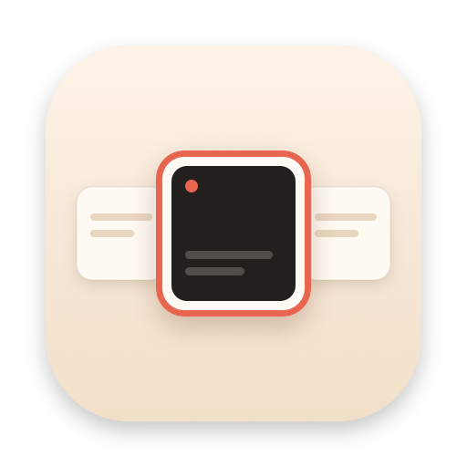
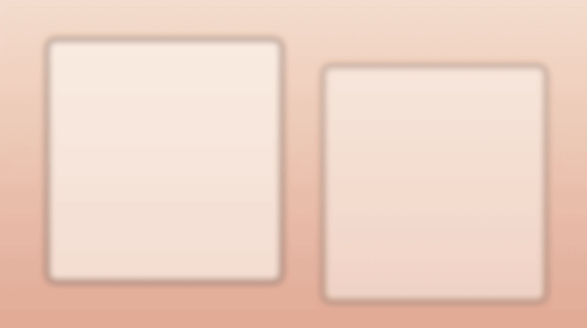
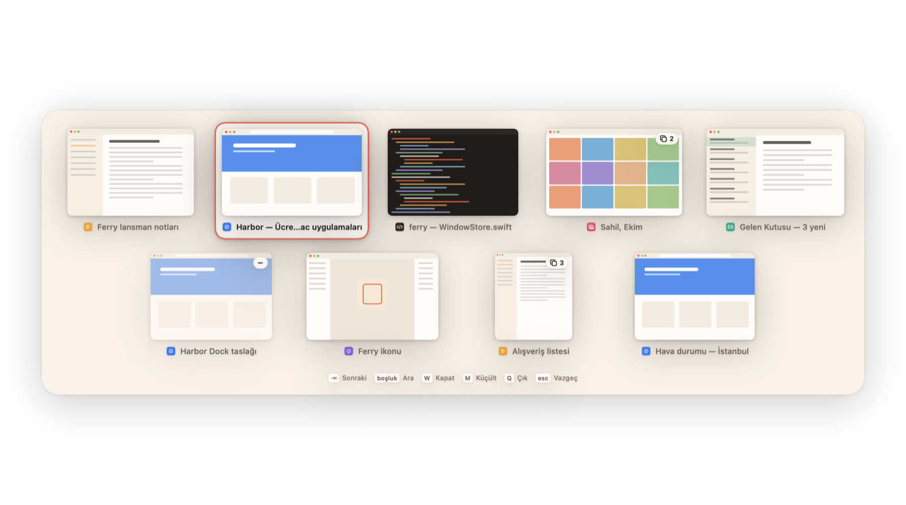
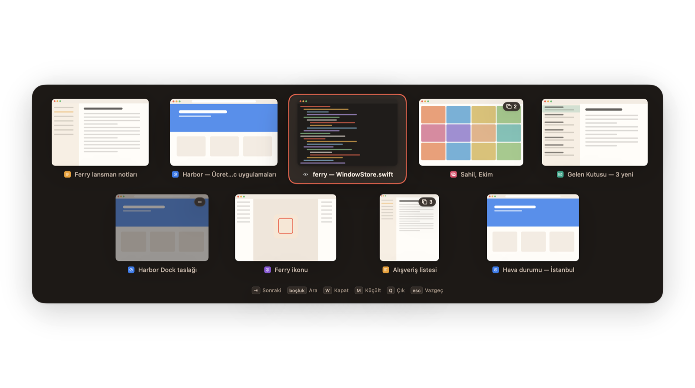
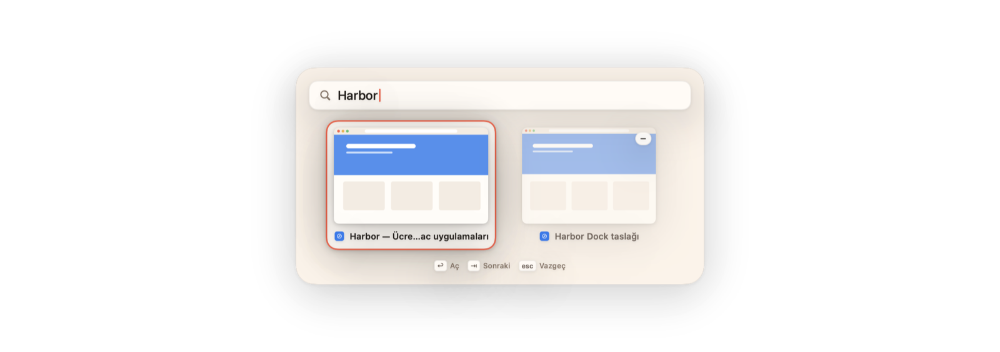
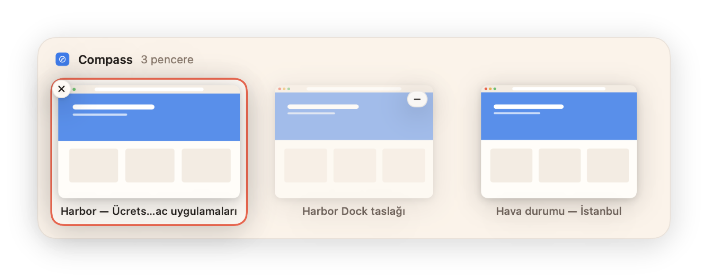
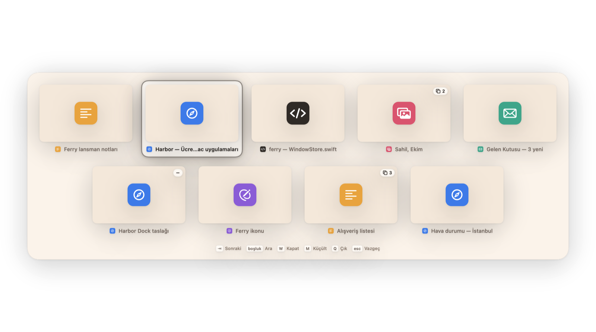

<p align="center">
  
</p>

<h1 align="center">Ferry</h1>

<p align="center">
  <b>Her pencere bir Tab uzağında.</b><br>
  macOS için ücretsiz ve açık kaynak bir pencere değiştirici: ⌥’ye basılı tut, Tab’a dokun ve her pencereyi gör —<br>
  her Space’te, canlı görüntülerle, aramayla, hızlı işlemlerle ve Dock önizlemeleriyle.
</p>

<p align="center">
  <a href="https://github.com/Kaandis/ferry/releases/latest"></a>
  
  
  <a href="LICENSE"></a>
</p>

<p align="center">
  <a href="https://kaandis.github.io/ferry/">Web sitesi</a> ·
  <a href="https://github.com/Kaandis/ferry/releases/latest/download/Ferry.zip">İndir</a> ·
  <a href="README.md">English</a>
</p>

<p align="center">
  
</p>

## Ne yapar

| | |
|---|---|
| **Uygulama değil, pencere** — ⌥’ye basılı tut ve Tab’a dokun. Her pencerenin kendi kutusu var, en son kullanılan en başta; yani üç tarayıcı penceresi üç ayrı seçenek. Bırakınca geçersin. Hızlıca dokunup bırakırsan panel hiç görünmeden bir önceki pencereye dönersin. |  |
| **Her Space** — diğer masaüstlerindeki, küçültülmüş ve gizlenmiş pencereler de burada; nerede olduklarını küçük bir rozet söyler. Birini seçmek seni oraya götürür. |  |
| **Arama** — switcher açıkken Boşluk’a bas ve yaz. Pencere başlıklarında ve uygulama adlarında arar; Return ile geçersin. |  |
| **Dock önizlemeleri** — imleci bir Dock simgesinin üzerinde tut, o uygulamanın pencerelerini gör. Birine tıklayıp öne getir ya da oradan kapat. |  |
| **Görüntüsüz de çalışır** — Ekran Kaydı isteğe bağlı. İzin yoksa kutularda uygulama simgeleri görünür, gerisi aynen çalışır. |  |

Ayrıca: **W** kapatır, **M** küçültür, **Q** uygulamadan çıkar, **H** uygulamayı gizler — bırakmadan. Ok tuşları ve fare de çalışır. ⌥Tab, ⌘Tab (Ferry devralır, çıkınca geri verir) ya da ⌃Tab kullanabilirsin. Paneller Harbor’ın kremi ya da Liquid Glass (macOS 26 ve sonrası) görünümünde olabilir; seçim halkası da seçtiğin vurgu renginde olur (varsayılan yumuşak çakıl grisi). İkisi de **Ayarlar → Genel**’de. İmlecin olduğu ekranda açılır; Hareketi Azalt, Saydamlığı Azalt ve Kontrastı Artır tercihlerine uyar; İngilizce ve Türkçe konuşur.

## Neden böyle çalışıyor

- **Gerekene kadar uykuda.** Yoklama yok, kullanımlar arasında zamanlayıcı yok, global fare dinleyicisi yok. Ferry yalnızca klavye olaylarını (kısayolu yakalamak için) ve odak gerçekten değiştiğinde gelen Erişilebilirlik bildirimlerini dinler. Dock önizlemeleri fareyi takip etmez; Dock’un kendi üzerine gelme vurgusunu izler.
- **Pencere listesi kısayola bastığında kurulur.** Ana iş parçacığının dışında, 20–50 ms’de; arka planda sıcak tutulacak bir şey yok. Kapanan uygulamalar anında unutulur, haftalarca açık kalsa da birikme olmaz.
- **Görüntüler akış değil, tek kare.** ScreenCaptureKit her pencereden küçük, tek bir görüntü alır (uzun kenarı en fazla 560 px): switcher ya da bir Dock önizlemesi göstermek üzereyken ve bir uygulamadan ayrılırken. macOS başka Space’teki pencerelerin görüntüsünü vermediği için Ferry pencere ekrandayken aldığı son görüntüyü saklar.
- **Diğer Space’lerdeki pencereler tahminsiz.** Pencerenin hangi Space’te olduğu WindowServer’dan, başlığı ve türü Erişilebilirlik’ten gelir. Uygulamalar kapatılan pencereleri saklar (Music ve Calendar böyle yapar) ve bunlar hâlâ bir Space bildirir; Ferry yalnızca WindowServer’ın gerçekten gösterildiğini söylediği pencereleri listeler. Başlıksız pencereler de Erişilebilirlik üzerinden doğrulanır; yardımcı pencereler araya karışmaz.
- **Hızlı dokunuşta titreme yok.** Panel görünmeden önce 90 ms bekler. Hızlıca dokunup bırakırsan doğrudan önceki pencereye geçersin; sistemin kendi switcher’ı gibi.
- **Zaman çizelgesi değil, yay.** Panel ve seçim halkası, olduğu yerden başlayan kritik sönümlü yaylarla hareket eder: yarıda geri çevirebilirsin, hiçbir şey sıçramaz. Panelin girişi ve çıkışı Core Animation’da çalışır, yani içerik bir kez çizilir. Hareketi Azalt açıksa sadece belirip kaybolur.
- **Dock önizlemeleri sen gidince gider.** Önizleme açıkken, yalnızca o sırada, Ferry imleci izler; imleç ne Dock’ta ne önizlemede olduğu an önizleme kapanır.
- **Kendi web sitesinde kenara çekilir.** Öndeki sayfa Ferry’nin sitesiyse ⌥Tab sayfaya gider; böylece demo Ferry kuruluyken de çalışır.
- **Çalışmak için bir izin, görüntüler için bir izin.** İkisi de karşılama penceresinde anlatılır; Sistem Ayarları’nda anahtarı açtığın anda durum güncellenir.

## Ölçülen kaynak kullanımı

M4 Pro’da (macOS 27, tek 2560×1440 ekran, üç Space’e dağılmış yaklaşık on pencere), Debug derlemesiyle:

| | |
|---|---|
| Boştayken CPU (60 sn, hiç girdi yok) | **0,00 sn** CPU zamanı, 1 uyanma |
| Kısayoldan pencere listesine | medyan **22 ms** (15–67 ms) |
| Bir geçiş (aç, iki adım, kapat) | **~0,25 sn** CPU zamanı, sonra yeniden uyku |
| Bellek | **~30 MB** fiziksel ayak izi, görüntüler dahil |

Kendin de bakabilirsin: `top -pid $(pgrep -x Ferry) -stats pid,cpu,idlew,mem`

## Harbor

Ferry, **Harbor** ailesinin parçası. [Harbor](https://kaandis.github.io/harbor/) uygulamasını kurarsan tüm Harbor uygulamalarını tek yerde görür, güncellemelerden haberdar olur ve Ferry’nin ayarlarını orada değiştirirsin; Ferry’nin **Ayarlar…** menüsü de Harbor’daki sayfasını açar. Harbor yoksa Ferry kendi küçük Ayarlar penceresini kullanmaya devam eder.

## Kurulum

1. Son sürümden **[Ferry.zip](https://github.com/Kaandis/ferry/releases/latest/download/Ferry.zip)** dosyasını indir ve aç.
2. **Ferry.app**’i Uygulamalar klasörüne taşı.
3. İlk seferde Ferry’ye sağ tıklayıp **Aç**’ı seç. Sürümler henüz notarize edilmediği için macOS bir kez sorar. Yine de açmazsa:

```bash
xattr -dr com.apple.quarantine /Applications/Ferry.app
```

Ferry menü çubuğunda yaşar (vapur simgesi). Karşılama penceresi izinlerde sana yol gösterir; Ayarlar’da Genel, Switcher, Hariç Tutulanlar ve Hakkında sekmeleri var.

## İzinler

| İzin | Ne için | Gerekli mi? |
|---|---|---|
| Erişilebilirlik | Pencereleri listelemek, kısayolu yakalamak, pencereyi öne getirmek, Dock üzerine gelme | Evet — bu izin olmadan pencere değiştirilemez |
| Ekran Kaydı | Kutular ve Dock önizlemeleri için her pencereden tek bir görüntü | Hayır — izin yoksa uygulama simgeleri görünür |

macOS zaman zaman Ekran Kaydı iznini yeniden onaylamanı isteyebilir; bu sistemin davranışı, Ferry’nin değil.

## Gizlilik

Ağ erişimi yok, analiz yok, hesap yok. Pencere görüntüleri yalnızca bellekte durur, pencere kapanınca silinir, asla diske yazılmaz ya da bir yere gönderilmez. Ayarlar `~/Library/Preferences/app.ferry.Ferry.plist` içinde sıradan tercihler olarak durur.

## Kaynaktan derleme

Gerekenler: Xcode 16 veya üstü ve [XcodeGen](https://github.com/yonaskolb/XcodeGen).

```bash
brew install xcodegen
git clone https://github.com/Kaandis/ferry.git
cd ferry
xcodegen generate
open Ferry.xcodeproj
```

Erişilebilirlik izni uygulamanın imzasına bağlıdır. macOS’in izni derlemeler arasında hatırlaması için Debug derlemelerini kendi geliştirici sertifikanla imzala:

```bash
xcodebuild -project Ferry.xcodeproj -scheme Ferry -derivedDataPath build/dd CODE_SIGN_IDENTITY="Apple Development" DEVELOPMENT_TEAM=<takım kimliğin> build
```

Debug derlemeleri her arayüz durumunu uydurma pencerelerle PNG olarak çizebilir; hiçbir izin gerekmeden arayüz değişikliklerine bakmak için kullanışlı:

```bash
build/dd/Build/Products/Debug/Ferry.app/Contents/MacOS/Ferry --render-previews ./previews -AppleLanguages "(tr)"
```

`--transparent --gif` eklersen `scripts/make-gif.py`’nin yukarıdaki animasyona çevirdiği kareler de yazılır.

<details>
<summary>Proje yapısı</summary>

| Yol | İçinde ne var |
|---|---|
| `Ferry/Core` | Pencere listesi (Erişilebilirlik + WindowServer), odaklama ve işlemler, ScreenCaptureKit görüntü önbelleği, izinler, özel API köprüsü |
| `Ferry/Switcher` | Klavye olay dinleyicisi, switcher denetleyicisi, model, panel ve görünümler |
| `Ferry/DockPreview` | Dock üzerine gelme gözlemcisi, önizleme paneli ve görünümü |
| `Ferry/Onboarding` | Karşılama penceresi ve izin satırları |
| `Ferry/Design` | Harbor tasarım değerleri, yaylar, ortak bileşenler, Core Animation geçişleri |
| `Ferry/Settings` | Geçici ayarlar penceresi, tercihler, dil seçici |
| `Ferry/Resources/settings-schema.json` | Gelecek Harbor uygulaması için her tercihin tarifi |
| `Ferry/Resources/*.xcstrings` | Çeviriler |
| `docs/` | Web sitesi (GitHub Pages) |

</details>

## Çeviriler

Ferry İngilizce ve Türkçe konuşur, sistem dilini takip eder; **Ayarlar → Genel**’den de seçebilirsin. Metinler [`Ferry/Resources/Localizable.xcstrings`](Ferry/Resources/Localizable.xcstrings) içinde. `scripts/sync-strings.py` kataloğu bir Debug derlemesinden ve `scripts/translations-tr.json`’dan yeniden kurar.

## Bilinen sınırlamalar

- Başka Space’teki bir pencereyi öne getirmek, pencerenin hangi Space’te olduğunu okumak ve oradaki başlıksız pencereleri bulmak özel macOS arayüzlerine (SkyLight, `_AXUIElementGetWindow`) dayanır. Bir macOS güncellemesi, Ferry yetişene kadar bunları bozabilir.
- Başka Space’lerdeki pencerelerin görüntüleri en son gördüğün an kadar tazedir; macOS ekranda olmayan pencerelerin yakalanmasına izin vermez.
- Ferry’yi AltTab ya da DockDoor ile birlikte çalıştırmak aynı kısayolu ve aynı Dock hareketini dinleyen iki uygulama demek. Birini seç.

## Teşekkürler

**İlham.** Ferry fikrini Mac için sevilen iki açık kaynak pencere değiştiriciden alır: [AltTab](https://alt-tab.app) ve [DockDoor](https://dockdoor.net). Ferry bağımsız bir projedir: sıfırdan yazıldı ve onlarla hiç kod, görsel ya da metin paylaşmaz (ikisi GPL-3.0; Ferry MIT).

Ferry, tek bir tasarım diliyle yapılmış küçük bir ücretsiz Mac uygulamaları ailesi olan **Harbor**’ın parçası. Kardeşi [Inlet](https://kaandis.github.io/inlet/), bir çentik uygulaması.

## Sorumluluk reddi

Ferry bağımsız bir projedir; Apple Inc. ile bağlantılı değildir, Apple tarafından onaylanmamış veya desteklenmemiştir. Mac, macOS, Mission Control ve Spaces, Apple Inc.’in ABD’de ve diğer ülkelerde tescilli ticari markalarıdır.

## Lisans

[MIT](LICENSE)
